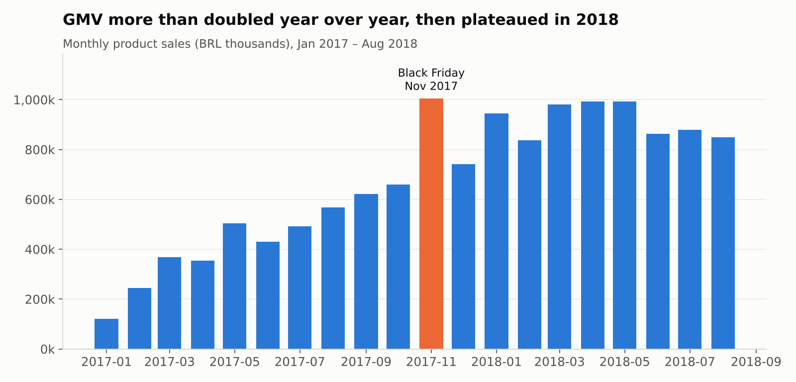
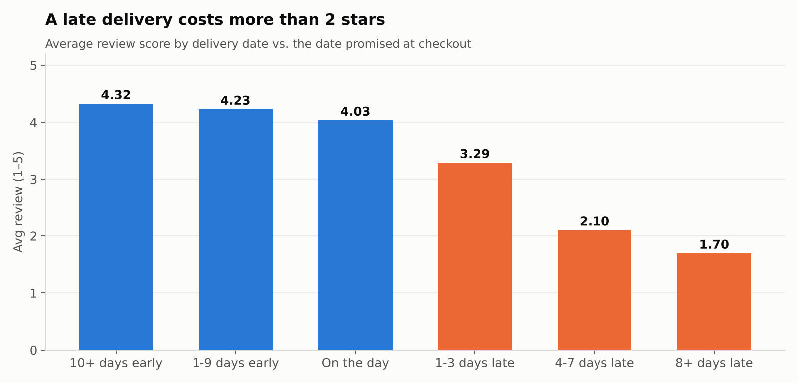
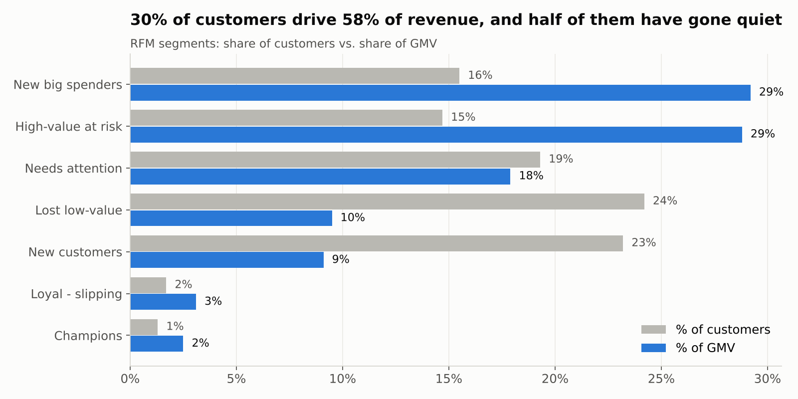
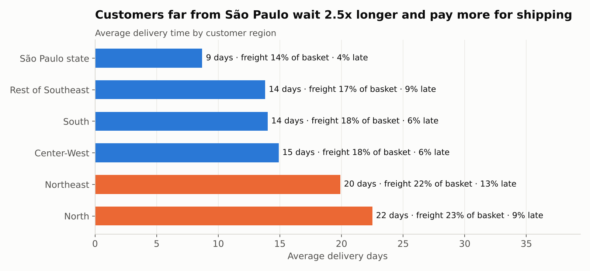
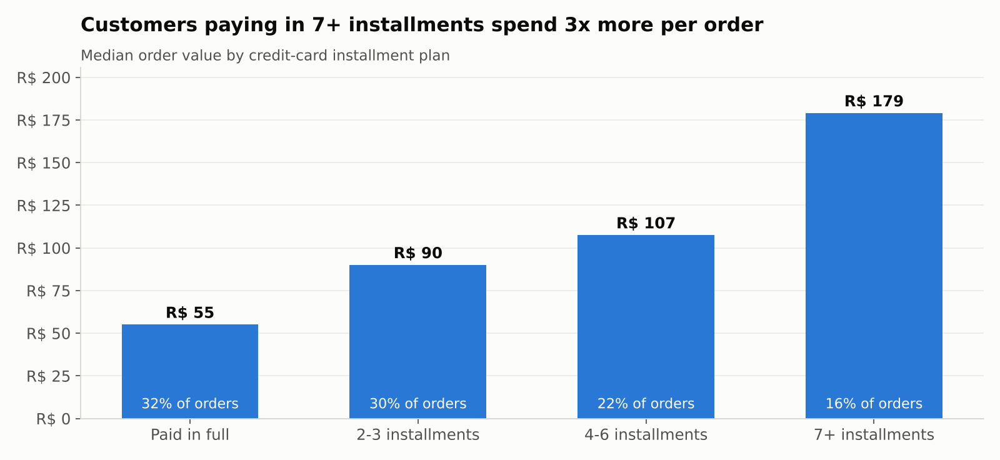

# Why Customers Leave: An E-Commerce Analysis in PostgreSQL

**100k real orders from Brazil's largest marketplace, analyzed end to end in SQL, to answer one question: where is this business losing money and customers, and what should it fix first?**


---

## TL;DR: five findings

| # | Finding | Evidence |
|---|---------|----------|
| 1 | **Late deliveries are 7% of orders but account for 33% of bad reviews.** A late order averages **2.3 stars** vs **4.3** on time. | [05](sql/analysis/05_delivery_vs_satisfaction.sql) |
| 2 | **Only 3% of customers ever buy twice**, and a great first experience doesn't change that: 5-star and 1-star first-time buyers return at the same rate. Retention is a *structural* problem, not a service-quality one. | [03](sql/analysis/03_retention_cohorts.sql) |
| 3 | **R$3.9M of past revenue (29% of GMV) sits with high-value customers who haven't ordered in over a year**, the clearest win-back target. | [04](sql/analysis/04_rfm_segmentation.sql) |
| 4 | **One seller handles 71% of the office-furniture category** and drags it to the platform's worst rating (3.39 vs 3.90 for every other seller in the category). | [07](sql/analysis/07_seller_performance.sql) |
| 5 | **Delivery promises are padded by ~12 days.** The median order arrives 12 days *before* the promised date, so checkout shows ~24 days for an order that takes ~12, which likely costs conversions. | [05](sql/analysis/05_delivery_vs_satisfaction.sql) |

---

## The business at a glance

Jan 2017 – Aug 2018 (20 complete months), excluding canceled and unavailable orders.

| Orders | Customers | GMV | Avg order | Avg review | Delivered late |
|-------:|----------:|----:|----------:|-----------:|---------------:|
| 97,905 | 94,703 | R$ 13.4M | R$ 137 | 4.12 / 5 | 6.8% |



GMV grew **+138%** year over year (Jan–Aug 2018 vs. 2017), but 2018 flattened out around R$0.84–1.0M per month and slipped **15% from May to August**. With almost no repeat buyers (finding 2), every real of revenue has to be re-bought through acquisition, and that is what a growth plateau looks like.

---

## 1 · Late delivery is the #1 driver of bad reviews



- Orders that arrive even **1–3 days late** drop to 3.29 stars; **8+ days late** scores 1.70, and **70%** of those reviews are 1 star.
- Late orders are only 6.7% of deliveries but account for **32.6% of all 1–2 star reviews on delivered orders**.
- Lateness is regional: **Ceará (13.8%), Bahia (12.2%) and Rio de Janeiro (12.1%)** are late about 3x as often as São Paulo (4.5%). Rio stands out because it is close to the São Paulo seller hub *and* the second-largest market.

**Recommendation:** Treat on-time delivery as the key satisfaction metric. Start with carrier performance on the Rio de Janeiro and Northeast lanes, which together cover about a fifth of deliveries.

## 2 · Retention is near zero, and it isn't about satisfaction

| | |
|---|---|
| Customers who ever ordered again | **3.0%** |
| Share of GMV from repeat customers | **5.6%** |
| Month-1 retention, any cohort | **< 0.75%** |

The obvious hypothesis was *"unhappy customers don't come back."* The data says otherwise:

| First-order review | Customers | Came back |
|:-:|--:|--:|
| ★ | 10,104 | 2.9% |
| ★★★ | 7,771 | 3.0% |
| ★★★★★ | 54,768 | 3.2% |

Delighted and furious customers return at almost the same rate. People buy a specific product from a marketplace and have no reason to come back, so fixing service alone won't move retention.

**Recommendation:** Retention needs a *reason to return*: post-purchase cross-sell emails, a loyalty or cashback program, or replenishment reminders for categories like health & beauty (the #1 category by GMV).

## 3 · Who to win back: RFM segmentation



Customers were scored on Recency, Frequency and Monetary value with `NTILE()` window functions and grouped into segments.

- **High-value at risk:** 13,934 customers, average spend R$278, last order **13 months ago** on average. Together they represent **R$3.9M** of historical GMV.
- **Champions** (repeat buyers who ordered recently) are just 1.3% of customers.

**Recommendation:** Point a win-back campaign at the high-value-at-risk segment first. Recovering even 5% of them at their historical spend is worth about R$190k.

## 4 · Category and seller concentration

- The **top 7 of 70+ categories produce 50% of GMV** (health & beauty, watches & gifts, bed/bath/table, sports, computer accessories, furniture/decor, housewares).
- The **top 10% of sellers (303 of ~3,000) generate 67% of GMV**; the bottom half of sellers produce 3%.
- **Office furniture** is the platform's lowest-rated major category (3.67 avg, 21% negative). It isn't a category problem: **one seller fulfils 71% of it** and averages 3.39, while everyone else selling office furniture averages 3.90.
- 13 sellers with 100+ orders review at least 0.4 stars below the platform average. Two of them get 1–2 star reviews on **48–60%** of their orders.

**Recommendation:** Build seller-quality monitoring (review score and late rate by seller, with thresholds), and start with the office-furniture seller, who alone damages a whole category.

## 5 · Geography and shipping cost



Customers in the **North and Northeast** wait **20–22 days** on average (vs. 9 in São Paulo state) and pay freight equal to **22–23% of their basket** (vs. 14%). They also buy *bigger* baskets (R$165–182 vs. R$125), which suggests they consolidate purchases to make shipping worth it.

**Recommendation:** Test regional fulfilment or freight subsidies for the Northeast, a big market that already buys large baskets despite slow, expensive delivery.

## 6 · Payments: installments raise basket size



78.5% of revenue is paid by credit card, and **68% of single-payment card orders are split into installments**. Orders paid in 7+ installments have a median value of **R$179**, vs. **R$55** for orders paid in full. *(This is correlation: bigger purchases are more likely to be split. It still shows installment availability matters for high-ticket categories.)*

---

## Recommendations, prioritized

| Priority | Action | Why | Expected impact |
|:--:|---|---|---|
| 1 | Fix carrier performance on RJ and Northeast lanes | Late = 33% of negative reviews | Higher ratings, fewer support tickets |
| 2 | Tighten delivery estimates (median 12 days padded) | A 24-day promise at checkout deters buyers | Higher checkout conversion |
| 3 | Win-back campaign for "High-value at risk" | 13.9k customers, R$3.9M historical GMV | ~R$190k per 5% reactivated |
| 4 | Seller quality scorecards + intervention | 1 seller sinks a whole category | Category rating 3.67 → ~3.9 |
| 5 | Loyalty / cross-sell program | 97% one-time buyers | Lower dependency on paid acquisition |

---

## How it's built

```
olist-sql/
├── sql/
│   ├── 01_schema.sql          # tables, types, primary & foreign keys
│   ├── 02_load.sql            # \copy CSVs + row-count checks
│   ├── 03_views.sql           # clean order-level fact views (business logic in one place)
│   └── analysis/
│       ├── 01_kpi_overview.sql
│       ├── 02_monthly_growth.sql
│       ├── 03_retention_cohorts.sql
│       ├── 04_rfm_segmentation.sql
│       ├── 05_delivery_vs_satisfaction.sql
│       ├── 06_category_performance.sql
│       ├── 07_seller_performance.sql
│       ├── 08_payments.sql
│       └── 09_freight_geography.sql
├── results/                   # output of every query, readable on GitHub
├── images/                    # charts generated from the database
└── scripts/
    ├── download_data.sh
    ├── run_all.sh             # rebuilds everything end to end
    └── make_charts.py
```

**Data model.** 8 tables loaded from the raw CSVs into a normalized schema with primary and foreign keys, so integrity is enforced on load. Three views (`v_orders` → `v_sales` → `v_delivered`) hold the business rules (analysis window, which statuses count as revenue, how lateness is defined), so every analysis query works from the same definitions.

**SQL techniques used**

| Technique | Where |
|---|---|
| CTEs, multi-table joins, `FILTER` aggregates | everywhere |
| `LAG()`, rolling averages with window frames | [02 growth](sql/analysis/02_monthly_growth.sql) |
| Cohort indexing with `MIN() OVER`, `AGE()`, pivoted retention matrix | [03 retention](sql/analysis/03_retention_cohorts.sql) |
| `NTILE()` scoring, `CASE` segmentation, share-of-total with `SUM() OVER ()` | [04 RFM](sql/analysis/04_rfm_segmentation.sql) |
| Running totals for a Pareto curve | [06 categories](sql/analysis/06_category_performance.sql) |
| `PERCENT_RANK()` tiers, leave-one-out comparison with window sums | [07 sellers](sql/analysis/07_seller_performance.sql) |
| `PERCENTILE_CONT` medians | [08 payments](sql/analysis/08_payments.sql) |
| `DISTINCT ON` de-duplication | [03 views](sql/03_views.sql) |

**Data-quality decisions**
- **Analysis window = Jan 2017 – Aug 2018.** 2016 has ~330 launch-period orders and Sep–Oct 2018 only 20 orders (data cut-off); including them would distort growth and cohort numbers.
- **Customers are counted by `customer_unique_id`.** The source `customer_id` is per order, so using it would make every customer look like a first-time buyer.
- **`review_id` isn't unique** in the source (547 orders have more than one review), so the key is `(review_id, order_id)` and the latest review per order is used.
- **Canceled / unavailable orders and the 775 orders with no line items are excluded** from revenue metrics.
- **Seller and category reviews use single-seller / single-category orders only**, so a review is never credited to the wrong seller.

## Run it yourself

Requires PostgreSQL 13+ and Python 3.9+.

```bash
git clone https://github.com/BaluModhvadiya/olist-ecommerce-sql-analysis.git
cd olist-ecommerce-sql-analysis
pip install -r requirements.txt

createdb olist
export PGDATABASE=olist          # plus PGHOST / PGUSER if needed
bash scripts/run_all.sh          # downloads data, builds DB, runs all analyses, draws charts
```

Each analysis file also runs on its own in psql, DataGrip or any SQL client once the schema and views exist.

## Data

[Brazilian E-Commerce Public Dataset by Olist](https://www.kaggle.com/datasets/olistbr/brazilian-ecommerce), released by Olist under CC BY-NC-SA 4.0: real, anonymized orders placed between 2016 and 2018.

---

*Balu Modhvadiya · Data Analytics · Berlin* · [GitHub](https://github.com/BaluModhvadiya)
